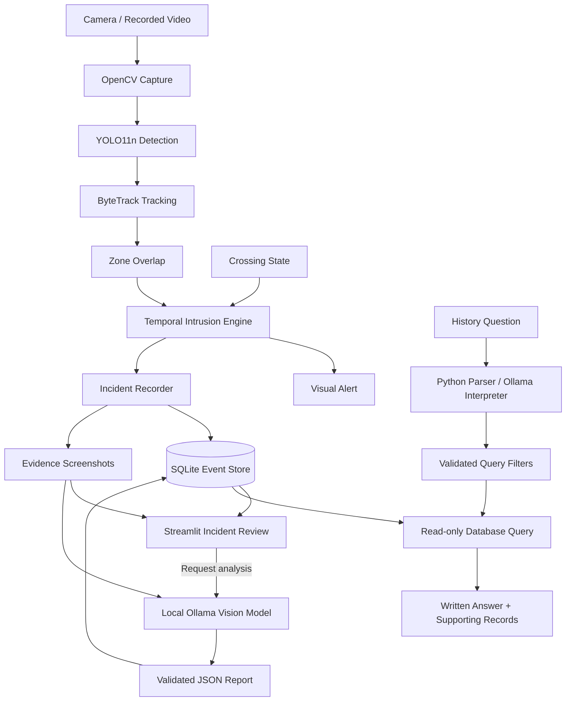

<div align="center">

# 🚦 Level Crossing Safety Monitoring System

### Automated Intruder Alerting via Edge Vision

**Detect · Track · Escalate · Preserve · Explain · Query**

An edge vision platform for vehicle intrusion monitoring, evidence management, and natural-language incident intelligence at level crossings.

**Python · YOLO11n · ByteTrack · OpenCV · Ollama · SQLite · Streamlit**

</div>

---

## Overview

The Level Crossing Safety Monitoring System converts video observations into structured, searchable incident records. It detects vehicles, follows their movement across frames, evaluates occupancy within a configured crossing zone, and raises visual alerts when a vehicle occupies that zone while the crossing is marked closed.

The system models an intrusion as a continuing event. Each tracked vehicle has an independent timer, escalation state, and incident record. Evidence captured during that event can be reviewed through a dashboard and analysed by a locally hosted vision-language model.

A natural-language history interface connects monitoring with retrospective investigation. Users can ask which incidents lasted longest, how many occurred on a particular day, or which exceeded a duration threshold.

The PC performs detection, tracking, event processing, storage, and AI inference locally. A webcam, connected Android camera, or recorded video supplies the input.

> **Implementation scope:** Crossing state is currently supplied through a software control. The application provides visual alerts and incident intelligence; physical barrier control and railway signalling integration are future extensions.

## Contents

- [Core capabilities](#core-capabilities)
- [Novelty and technical contributions](#novelty-and-technical-contributions)
- [System architecture](#system-architecture)
- [Technology stack](#technology-stack)
- [Project structure](#project-structure)
- [Installation](#installation)
- [Camera setup](#camera-setup)
- [End-to-end workflow](#end-to-end-workflow)
- [Intrusion logic](#intrusion-logic)
- [Incident storage and evidence](#incident-storage-and-evidence)
- [Ollama incident analysis](#ollama-incident-analysis)
- [Natural-language incident history](#natural-language-incident-history)
- [Configuration](#configuration)
- [Validation and evaluation](#validation-and-evaluation)
- [Troubleshooting](#troubleshooting)
- [Operational considerations](#operational-considerations)
- [Roadmap](#roadmap)

## Core capabilities

| Capability | Implementation |
|---|---|
| Video ingestion | Live camera capture and recorded-video processing |
| Vehicle detection | Pretrained YOLO11n through Ultralytics |
| Tracking across frames | ByteTrack with temporary object identities |
| Crossing-zone definition | Four-point polygon selected directly on the camera image |
| Context-aware intrusion detection | Vehicle overlap evaluated together with crossing state |
| Temporal escalation | ENTRY, PERSISTENT, and PROLONGED states |
| Independent event monitoring | Separate timers and records for concurrent tracks |
| Detection-gap handling | Grace period for brief tracking interruptions |
| Automated visual alerting | Annotated monitoring window with intrusion state and duration |
| Persistent incident history | SQLite records with timestamps, durations, levels, and end reasons |
| Evidence preservation | Screenshots linked to incidents and observed escalation stages |
| Local incident explanation | Ollama-based analysis of saved visual evidence |
| Structured report validation | Pydantic validation before accepting generated analysis |
| Incident-review dashboard | Filtering, summaries, evidence inspection, and report generation |
| Natural-language investigation | Written answers with supporting incident records |
| Export | CSV incident data and JSON analysis reports |

## Novelty and technical contributions

The project's contribution is the integration of temporal event modelling, local visual explanation, and database-grounded investigation into one monitoring workflow.

### 1. Contextual and temporal intrusion modelling

A detection becomes an intrusion only when the tracked vehicle overlaps the crossing zone and the crossing is marked closed.

The event then progresses through duration-based states. This preserves the relationship between an initial entry and a prolonged occupancy episode, while keeping separate records for different tracked objects.

**Contribution:** A crossing-state-aware event model that combines spatial occupancy, object identity, and elapsed time.

### 2. Independent alerting and explanation paths

The rule engine generates visual alerts directly from tracking, geometry, crossing state, and timing. Ollama analyses saved evidence separately.

Report generation is therefore outside the alert decision path. An unavailable language model does not prevent the rule engine from identifying an intrusion.

**Contribution:** An architecture that separates time-sensitive event decisions from optional AI interpretation.

### 3. Evidence-linked incident intelligence

An incident connects its identifier, source, timestamps, duration, highest escalation state, screenshots, and analysis report.

This gives users a path from a dashboard summary to the recorded facts and visual evidence behind it.

**Contribution:** Traceable event records that support inspection, comparison, and retrospective analysis.

### 4. Hybrid natural-language investigation

Recognized questions are parsed directly in Python. Other supported wording is interpreted by Ollama into validated search fields.

Python executes fixed database queries and constructs the answer from stored values. The model does not generate executable SQL or calculate incident statistics.

**Contribution:** A history interface combining language flexibility with deterministic filtering, aggregation, and ranking.

### 5. Local perception and language processing

Detection and analysis run on the local PC, with incident records and evidence stored locally. Core inference does not require a cloud model service once dependencies and model weights are available.

**Contribution:** A locally hosted monitoring and investigation pipeline with explicit control over models and stored evidence.

These are system-design contributions built using established models and libraries. Claims of research originality or superior performance require comparative experiments and a literature review.

## System architecture



### Processing responsibilities

| Path | Responsibility |
|---|---|
| Monitoring | Capture, detection, tracking, geometry, escalation, and visual alerts |
| Recording | Incident lifecycle, database updates, and stage evidence |
| Analysis | On-demand interpretation of saved evidence and report validation |
| Investigation | Read-only history queries, written answers, and supporting records |

Live monitoring appears in an OpenCV window. The Streamlit application provides review and investigation of stored incidents.

## Technology stack

| Layer | Technology | Role |
|---|---|---|
| Language | Python | Application logic and component integration |
| Video processing | OpenCV | Capture, drawing, polygon masks, and image export |
| Numerical operations | NumPy | Image and geometry calculations |
| Detection | Ultralytics YOLO11n | Object localization and classification |
| Tracking | ByteTrack through Ultralytics | Frame-to-frame object association |
| Inference runtime | PyTorch through Ultralytics | Detector execution; current code uses CPU |
| Local AI runtime | Ollama | Local model serving |
| Vision-language model | Qwen3-VL 2B Instruct | Evidence descriptions and query interpretation |
| Validation | Pydantic | Structured analysis and query validation |
| Storage | SQLite | Incident, snapshot, and analysis records |
| Dashboard | Streamlit | Review, filters, reports, and history questions |
| Model communication | Ollama Python SDK and HTTPX | Local API communication |

## Project structure

```text
level-crossing-monitor/
├── app.py                         # Streamlit application and navigation
├── requirements.txt
├── README.md
├── .gitignore
├── check_cameras.py               # Optional camera-index helper
│
├── crossing_monitor/
│   ├── __init__.py
│   ├── video.py                   # Video input and monitoring entry point
│   ├── detector.py                # YOLO inference
│   ├── tracker.py                 # ByteTrack integration
│   ├── zones.py                   # Polygon selection and overlap checks
│   ├── escalation.py              # Per-track temporal state
│   ├── storage.py                 # SQLite persistence and CSV export
│   ├── evidence.py                # Screenshot writing
│   ├── recorder.py                # Incident lifecycle coordination
│   ├── ollama_analysis.py         # Evidence analysis and report storage
│   ├── dashboard_data.py          # Dashboard queries and filtering
│   ├── history.py                 # Question parsing and history queries
│   └── history_page.py            # History interface
│
├── models/
│   └── yolo11n.pt                 # Downloaded detector weights
│
├── data/
│   ├── videos/                    # Optional recorded inputs
│   └── runtime/
│       ├── incidents.db
│       ├── evidence/
│       └── reports/
│
└── tests/                         # Available component tests
```

Model weights, runtime records, private recordings, and local environments should remain outside version control.

## Installation

### 1. Create the Python environment

Run these PowerShell commands from the project root:

```powershell
python -m venv .venv
.\.venv\Scripts\python.exe -m pip install --upgrade pip
.\.venv\Scripts\python.exe -m pip install -r requirements.txt
```

Using the environment's Python executable directly avoids requiring virtual-environment activation.

The requirements file should include:

```text
opencv-python
numpy
ultralytics
lap>=0.5.12
ollama
pydantic>=2
httpx
streamlit>=1.50,<2
```

### 2. Prepare Ollama

Install and open Ollama, then download the analysis model:

```powershell
ollama pull qwen3-vl:2b-instruct
ollama list
```

Keep the Ollama application running. If its service is not already available, start it in a separate terminal:

```powershell
ollama serve
```

The application connects to the local Ollama service at `http://localhost:11434`.

Use the explicit `qwen3-vl:2b-instruct` model tag for this workflow. The generic tag previously produced responses containing thinking output without a usable final answer.

### 3. Prepare detector weights

The detector downloads `yolo11n.pt` into the model directory when first loaded if the weights are missing. Allow the initial download to finish before expecting camera inference.

## Camera setup

### Webcam or connected camera

Preview a camera before starting monitoring:

```powershell
.\.venv\Scripts\python.exe -m crossing_monitor.video --camera 0
```

If another camera is needed, close the preview with **Q** and try another index:

```powershell
.\.venv\Scripts\python.exe -m crossing_monitor.video --camera 1
```

The index depends on the cameras Windows exposes.

### Android camera through Windows

1. Pair the Android device through **Link to Windows**.
2. On the PC, open **Settings → Bluetooth & devices → Mobile devices → Manage devices**.
3. Enable **Use as connected camera** for the paired device.
4. Approve camera access on the phone.
5. Find its camera index using the preview command.

If the optional helper is included:

```powershell
.\.venv\Scripts\python.exe check_cameras.py
```

Press **N** to move to the next camera and **Q** to quit.

Mount the camera securely. Changing its position after selecting the zone invalidates that zone's alignment.

## End-to-end workflow

### Step 1 — Start monitoring

Replace `1` with the correct camera index:

```powershell
.\.venv\Scripts\python.exe -m crossing_monitor.video --camera 1 --monitor
```

To process a saved recording:

```powershell
.\.venv\Scripts\python.exe -m crossing_monitor.video --video "data/videos/sample.mp4" --monitor
```

### Step 2 — Define the crossing zone

On the paused initial frame:

1. Click four corners in clockwise or anticlockwise order to form a convex polygon.
2. Press **Enter** to confirm.
3. Press **R** to reset the selection or **Q** to cancel.

Zone selection currently takes place at the beginning of each monitoring session.

### Step 3 — Set the crossing state

The crossing starts **Open**. Press **C** to switch between Open and Closed.

| Control | Function |
|---|---|
| Left mouse click | Add a zone corner during selection |
| Enter | Confirm the zone |
| R | Reset the zone selection |
| C | Toggle crossing state during monitoring |
| Q | Stop the current preview or monitoring session |

### Step 4 — Monitor and record

For each supported vehicle, the system evaluates zone overlap and crossing state.

A qualifying intrusion creates an incident, shows a visual alert, and saves entry evidence. Continued occupancy updates the same event and captures later escalation stages when observed.

Press **Q** for a normal shutdown. Remaining incidents are closed and CSV export is attempted.

### Step 5 — Open incident review

In another terminal:

```powershell
.\.venv\Scripts\python.exe -m streamlit run app.py
```

Open the Local URL printed by Streamlit, normally `http://localhost:8501`.

The application provides:

| Page | Purpose |
|---|---|
| **Incident review** | Filter records, inspect facts and screenshots, generate analysis, and download results |
| **Ask incident history** | Ask questions and inspect written answers with supporting records |

Click **Refresh records** after new monitoring activity. The review page loads the latest 1,000 incidents; history calculations use all database records matching the query.

### Step 6 — Analyse an incident

Select a closed incident, open its Ollama report section, and generate analysis.

For command-line processing:

```powershell
.\.venv\Scripts\python.exe -m crossing_monitor.ollama_analysis --model qwen3-vl:2b-instruct --timeout 600
```

To process up to three pending incidents:

```powershell
.\.venv\Scripts\python.exe -m crossing_monitor.ollama_analysis --limit 3 --model qwen3-vl:2b-instruct --timeout 600
```

Use `--incident` followed by an incident ID or unique prefix to select a record. Add `--force` to replace an existing analysis.

### Step 7 — Investigate incident history

Open **Ask incident history** and ask a standalone question:

- How many intrusions happened today?
- Tell me about yesterday's incidents.
- Which incident lasted longest?
- Which incident lasted more than 8 seconds?
- Show prolonged incidents.

The page displays a written answer first. Expand **Interpreted search** to inspect the filters or **Supporting records** to inspect matching rows.

### Additional processing modes

```powershell
# Detection only
.\.venv\Scripts\python.exe -m crossing_monitor.video --camera 1 --detect

# Detection and tracking
.\.venv\Scripts\python.exe -m crossing_monitor.video --camera 1 --track
```

Use one processing mode at a time: `--detect`, `--track`, or `--monitor`.

## Intrusion logic

### Spatial condition

The zone test uses the fraction of the vehicle's visible bounding box covered by the crossing polygon:

```text
overlap_ratio = pixels_inside_zone_and_box / pixels_inside_visible_box

intrusion = supported_vehicle
            AND crossing_is_closed
            AND overlap_ratio >= 0.10
```

This is an image-space occupancy estimate. It does not measure the vehicle's physical footprint on the road.

### Temporal escalation

| Level | Default condition | Meaning |
|---|---|---|
| ENTRY | First qualifying observation | Intrusion episode begins |
| PERSISTENT | At least 3 seconds | Occupancy has continued |
| PROLONGED | At least 6 seconds | Occupancy has continued beyond the second threshold |

These levels describe observed persistence. They do not estimate collision probability.

### Tracking continuity

Each track has an independent timer. A one-second grace period tolerates brief missing detections; the displayed duration and escalation state freeze while the track is unseen.

Reappearance within the tolerated interval retains the episode, including the bridged interval in its elapsed time. An expired episode closes at its last confirmed inside observation.

A confirmed outside observation or opening the crossing ends the active episode.

The monitoring path currently checks vehicle classes. Person detections available in other modes are excluded from vehicle-intrusion checks.

## Incident storage and evidence

### Data model

| Table | Main contents |
|---|---|
| `incidents` | Incident UUID, source, track ID, timestamps, duration, highest level, status, and end reason |
| `snapshots` | Incident reference, escalation stage, image path, and capture timestamp |
| `incident_analyses` | Incident reference, model, analysis timestamp, generation time, and report JSON |

The analysis table is created when the analysis component is first used.

### Generated files

```text
data/runtime/
├── incidents.db
├── evidence/
│   ├── <incident_id>_entry.jpg
│   ├── <incident_id>_persistent.jpg
│   └── <incident_id>_prolonged.jpg
└── reports/
    ├── incidents.csv
    └── <incident_id>_analysis.json
```

Screenshots are saved only for stages observed by the recorder.

### Incident closure

| End reason | Interpretation |
|---|---|
| `zone_exit` | Vehicle was observed outside the configured zone |
| `crossing_open` | Crossing state changed to Open |
| `track_lost` | Tracking interruption exceeded the grace period |
| `monitor_stopped` | Monitoring ended normally |

A closure reason records why monitoring of the episode ended. Only a confirmed zone exit establishes an observed departure.

### Inspect and export records

```powershell
.\.venv\Scripts\python.exe -m crossing_monitor.storage --limit 10

.\.venv\Scripts\python.exe -m crossing_monitor.storage --export data/runtime/reports/incidents.csv
```

## Ollama incident analysis

The analysis component combines a saved incident screenshot with its recorded context.

| Report element | Source |
|---|---|
| Incident facts | Database values |
| Duration and escalation summary | Python-generated text using stored facts |
| Scene description | Vision-language model |
| Visible observations | Vision-language model |
| Uncertainties | Vision-language model |
| Model and generation metadata | Analysis process |

Generated responses are checked for a usable final answer, completion status, valid JSON, and conformance to the expected Pydantic schema.

Empty, truncated, or malformed responses are rejected. The original incident remains available when analysis fails.

A valid schema establishes structural consistency. Visual claims still require checking against the evidence. A single screenshot cannot establish speed, continuous movement, or the cause of an event.

Reports can be reviewed in Streamlit, downloaded as JSON, or regenerated.

## Natural-language incident history

### Query pipeline

```text
User question
      ↓
Recognized Python grammar or Ollama interpretation
      ↓
Validated action and search fields
      ↓
Explicit date and duration checks
      ↓
Fixed parameterized, read-only SQL
      ↓
Database aggregation or record selection
      ↓
Written answer and supporting incident IDs
```

### Supported investigation

| Question | Database operation |
|---|---|
| How many intrusions happened today? | Count matching incidents by local calendar date |
| Tell me about yesterday's incidents. | Summarize matching counts, levels, and durations |
| Which incident lasted longest? | Rank by recorded duration |
| Which incident lasted more than 8 seconds? | Filter using `duration > 8` |
| Show incidents lasting at least 8 seconds. | Filter using `duration >= 8` |
| Show prolonged incidents. | Filter by highest recorded level |

Supported query fields include date range, duration bounds, highest escalation level, record status, and source.

The distinction between strict and inclusive comparisons is preserved. An event lasting exactly eight seconds is excluded by “more than 8” and included by “at least 8”.

Counts and aggregate statistics use all matching records. Supporting rows have a separate display limit, normally 10 and at most 50. Written previews show up to five incident IDs.

Each question is independent. Saved chat answers reflect the database when the question was asked. Requests for unrecorded attributes, such as vehicle speed or colour-based history filtering, are outside the current query schema.

## Configuration

Current settings are defined in the relevant Python modules.

| Setting | Default | Location |
|---|---|---|
| Detector weights | `models/yolo11n.pt` | `detector.py` |
| Detection confidence | `0.4` | `ObjectDetector` |
| Tracking detection confidence | `0.1` | `ObjectTracker` |
| Inference image size | `640` | Detector and tracker calls |
| Inference device | `cpu` | Detector and tracker calls |
| Minimum zone overlap | `0.10` | Monitoring logic in `video.py` |
| Persistent threshold | `3.0 seconds` | `EscalationMonitor` |
| Prolonged threshold | `6.0 seconds` | `EscalationMonitor` |
| Missing-track grace | `1.0 second` | `EscalationMonitor` |
| Dashboard/history model | `qwen3-vl:2b-instruct` | `app.py` and `history.py` |
| Incident database | `data/runtime/incidents.db` | Storage module |

The analysis commands specify the model explicitly. When changing image size or inference device, update detection and tracking consistently.

## Validation and evaluation

### Functional verification

Where test modules are included:

```powershell
.\.venv\Scripts\python.exe -m unittest discover -s tests -v
```

Confirm that tests are discovered and executed.

| Scenario | Expected behaviour |
|---|---|
| Empty crossing | No vehicle-intrusion record |
| Occupied crossing while Open | Occupancy without a closed-crossing intrusion |
| Brief entry while Closed | ENTRY record and evidence |
| Occupancy beyond three seconds | PERSISTENT escalation |
| Occupancy beyond six seconds | PROLONGED escalation |
| Multiple tracked vehicles | Independent event timers |
| Observed exit | Closure with `zone_exit` |
| Missing detections beyond grace | Closure with `track_lost` |
| Invalid model response | Analysis rejected; incident retained |
| No history matches | Explicit written no-match answer |
| Exact duration boundary | Strict and inclusive queries produce different results |

### Research evaluation plan

The architecture supports evaluation at three levels:

| Level | Suggested measurements |
|---|---|
| Perception | Vehicle detection precision/recall, ID switches, and processing throughput |
| Event monitoring | Event precision/recall, missed incidents, false alerts per hour, and alert latency |
| Incident intelligence | Visual factual accuracy, unsupported claims, query correctness, and analysis latency |

Potential comparisons include:

- Frame-based occupancy alerts versus tracked temporal episodes.
- Monitoring throughput with and without concurrent Ollama analysis.
- Model-only query interpretation versus the hybrid history parser.
- Performance across lighting, camera angle, occlusion, and object scale.

Use independently annotated recordings and separate sessions for development and evaluation. Define event-matching rules before calculating event metrics.

These are proposed experiments. This README does not report benchmark results or measured performance improvements.

## Troubleshooting

| Issue | Action |
|---|---|
| Wrong camera feed | Close the preview and try another index |
| Connected camera unavailable | Check Windows device pairing, permissions, and the connected-camera toggle |
| Zone no longer aligns | Restart monitoring and select the polygon again |
| Vehicle detections are unstable | Check lighting, object scale, focus, and occlusion |
| Inference is slow | Check CPU load and review input resolution; benchmark any changes |
| Ollama connection fails | Open Ollama and check service availability |
| No usable final model answer | Verify the explicit `qwen3-vl:2b-instruct` model is installed and selected |
| History gives an unexpected answer | Inspect interpreted filters and confirm the latest history parser is installed |
| History page is missing | Register both pages in `app.py` and restart Streamlit |
| Records appear outdated | Refresh incident review or submit a new history question |
| Evidence cannot be opened | Check its saved absolute path and file availability |
| CSV export fails | Close applications holding the destination file open |
| Record remains active after a crash | Abrupt termination can leave the last committed status active; automatic recovery is planned |

## Operational considerations

- **Crossing input:** The current Open/Closed state is controlled through the application. Automatic signal or barrier-state acquisition requires additional integration.
- **Camera geometry:** Moving the camera requires zone recalibration. Occlusion and perspective can affect bounding-box overlap.
- **Timing:** Live durations use elapsed PC observation time. Recorded-video durations use frame index and FPS, with a fallback when FPS is unavailable.
- **Dates:** UTC record timestamps represent processing activity. Calendar searches use the incident's start time in the PC's local timezone, rather than the original filming date.
- **Identity:** Tracking IDs can change after loss or occlusion. Incident counts represent tracking episodes, rather than unique physical vehicles.
- **Evidence portability:** Screenshot references currently use absolute paths. Moving data requires preserving or updating those references.
- **Model context:** Review evidence-analysis prompts and scene assumptions when adapting the system to a new camera domain.
- **Deployment readiness:** Field use requires site-specific data, detection validation, reliability testing, and integration with the intended operational environment.

## Roadmap

### Implemented

- [x] Camera and recorded-video input
- [x] YOLO detection and ByteTrack tracking
- [x] Polygon-based crossing-zone selection
- [x] Crossing-state-aware intrusion detection
- [x] Per-track temporal escalation
- [x] Visual intrusion alerts
- [x] SQLite incident history and stage evidence
- [x] CSV and JSON exports
- [x] Local Ollama evidence analysis
- [x] Incident-review dashboard
- [x] Natural-language history with supporting records

### Planned extensions

- [ ] Intrusion occupancy and entry heatmaps
- [ ] Evaluation dashboard using labelled reference events
- [ ] Background analysis queue with resource limits
- [ ] Saved camera-specific zone configurations
- [ ] Incident replay clips
- [ ] Camera health monitoring
- [ ] Interrupted-session recovery
- [ ] Optional audio and external notifications
- [ ] Automatic crossing-state input integration

---

<div align="center">

**Edge perception. Temporal event reasoning. Evidence-backed incident intelligence.**

</div>
